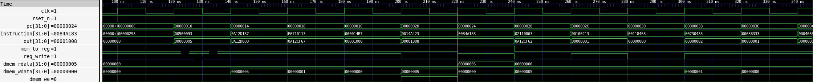

# Risc V CPU 

This project has the objective of creating a single cycle CPU using riscV-RV32I architecture.

## Key Features
- ISA: subset of RV32I (see **Supported instructions**)
- **Harvard Microarchitecture**: single-cycle, Harvard (separate instruction and data memory)
- **HDL**: SystemVerilog
- **Verification**: **cocotb** testbench on **Verilator**, waveforms viewable in **GTKWave**
- **Clock frequency** in the simulation: 50 MHz (20 ns period)


# Microarchitecture
The following image shows the complete datapath of the single cycle cpu. the CPU uses a Harvard architecture (instead of a Von Neumann one). The choice is necessary for a single cycle implementation, since it is imperative to execute an instruction with the data in a single clok cycle (not possible if the data and instruction memory arent separate).


<p align="center">
  
</p>

# File tree
the files of the repository are divided in:
  - RTL: contains the SystemVer
  - testbench (tb)
  - Simulation

## RTL
the Hardware Descriptive language used is **SystemVerilog**, chosen for it's ease of use and industry recognition. The code structure is described from the  `Top_level`, which inplements the `RTL_core`
and the *memory registers* . the kernel of the project Is represented by the core, which has instances of all the logic described in the datapath and control unit. The components of the core are the:
- `ALU` : The arithmetic logic unit, which implemnts the following operations:
  - `ALU_ADD`: sum
  - `ALU_SUB`: subtraction
  - `ALU_AND`: and bitwise
  - `ALU_OR`:  or bitwise
  - `ALU_XOR`: xor bitwise
  - `ALU_SLT`: comparison with sign ( `out = 0x11111111` if a<b, else  `out = 0x00000000`)
  - `ALU_LUI`: takes only the second operand. It will be used for the Load upper Immediate operation.
- `control unit`: Recieves the instruction from the `instruction_memory` and outputs the necessary control signals
- `immediate_generator`: takes the instruction and generates extracts the immediate. Depending on the instruction, the immediate bits change position. 
- `program_counter`: used as a pointer to next instruction, with branch implementation.
- `register_files`: contains registers used for temporary data manipulation.
- `rv32I_core`: has all the other components instaces and connects the logic part together.

the memory is divided in:
- `instruction_memory`: contains the instruction from which the control unit generates the necessary control signals
- `data_memory`: contains the operand in the instructions

All the common variables used in differnt istances are described in the `isa package`.

### Instruction Supported
This project does not have all the instruction types expected by a full RV32I implementation. The chosen instruction types reported in the ISA package are the following:
- **R-type**
- **I-type** immediate.
-  **I-type load**
- **S-type store**
- **B-type branches**
- **j-type unconditional jumps**
- **I-type indirect jumps**
- **U-type**

these correspond to the supported instructions.

## Testbench
the CPU test is executed using cocotb (python). The script is used to simulate a clk source and test the results given by the RTL logic, which executes a hex program derived by the 
The file contained in the tesbench are:
- `makefile`: the file wich contains information necessary to proceed to the simulation. In the file are present references to:
  - program used for the simulation
  - program used for the traces visualisation
  - all rtl files wich will be tested
  - the cocobt python script
  - the RTL top level   
- `test_top.py`: the python program wich generates the clk and compares cpu output with the expected results. 
- `test_program.s`: the test program written in assembly using riskV sintax
- `program.hex`: the test program transformed in hexadecimal 
- `test_results`: the results given by performing the test

# Simulation results
## Running the simulation
### Requirements

- Linux (tested on Ubuntu) with Python 3.12
- [Verilator](https://www.veripool.org/verilator/) (TODO: version, run `verilator --version`)
- [cocotb](https://www.cocotb.org/) (TODO: version, run `pip show cocotb`)
- [GTKWave](https://gtkwave.sourceforge.net/) (optional, to view waveforms)

> The Verilator package from `apt` may be too old for recent cocotb releases.
> Check the cocotb documentation for the minimum supported version, or build Verilator from source.

### Quick start

```bash
git clone https://github.com/olegpetryshyn/riscV_CPU.git
cd riscV_CPU

python3 -m venv .venv
source .venv/bin/activate
pip install cocotb

cd tb
make
```

`make` compiles the RTL (`rtl/package/isa_pkg.sv` and `rtl/core/*.sv`) with Verilator, using `rv32I_top` as top module, and runs the cocotb testbench `test_top.py`.
At the end, cocotb prints a summary table; a passing run shows `PASS` for every test and `FAIL=0`.

### Viewing the waveform

```bash
gtkwave <waveform file>    # TODO: file name generated in tb/ (e.g. dump.vcd or dump.fst)
```

### Cleaning up

```bash
make clean
```
### Baseline Single-Cycle Execution Trace

Simulation waveform generated via Verilator and Cocotb, demonstrating execution of the implemented instruction set:




* **Clock Frequency:** 50 MHz (20 ns cycle time).
* *Memory Transactions Highlighted:*
  * 200 ns – 220 ns (SW): Data memory write assertion (dmem_we = 1) targeting address `0x00001008` with payload `0x00000005`.
  * 220 ns – 240 ns (LW): Single-cycle memory load (mem_to_reg = 1) retrieving `0x00000005` onto dmem_rdata with register write-back assertion (reg_write = 1).


# License and Copyright
This project is licensed under the **Apache License 2.0** - see the [LICENSE](License) file for details.

```text
Copyright (c) 2026 Oleg Petryshyn
